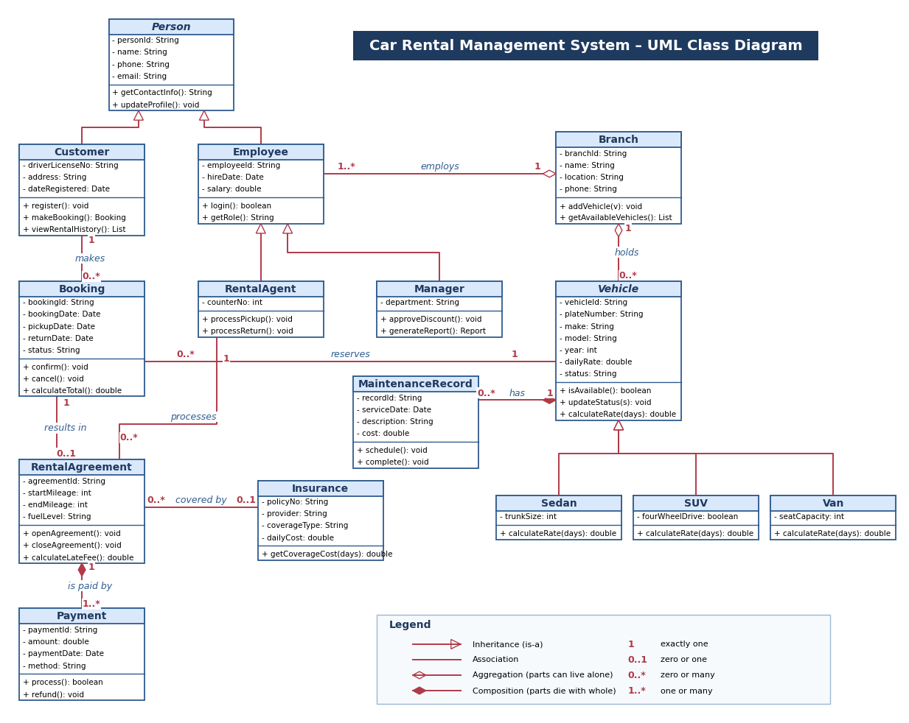

# Car Rental Management System – Group 3 (OOP I: UML Class Implementation)

Python implementation of the 15 classes in our UML class diagram (`diagram.drawio`).
## UML Class Diagram



[Open the editable diagram in Draw.io](https://app.diagrams.net/?url=https://raw.githubusercontent.com/briandebruno2-cyber/car-rental-uml-diagram-group3/main/diagram.drawio)

## How to run
Requires Python 3.9 or newer. No extra packages.

```
python main.py                         # runs the demo, results print in the terminal
python -m unittest discover -s tests   # runs the 9 automatic tests
```
`expected_output.txt` holds the output the demo should produce.

## Project structure
```
car_rental/
  people.py     Person (abstract), Customer, Employee, RentalAgent, Manager
  vehicles.py   Vehicle (abstract), Sedan, SUV, Van, MaintenanceRecord
  rental.py     Branch, Insurance, Booking, RentalAgreement, Payment
  utils.py      ID generator (VEH-001, BKG-001, ...)
main.py         demo with 8 sections
tests/          unit tests
```

## UML to code
| UML idea | Where in the code |
|---|---|
| Inheritance | `Customer(Person)`, `RentalAgent(Employee)`, `Sedan(Vehicle)` ... |
| Abstract classes | `Person` (guard in `__init__`), `Vehicle` (abstract `calculate_rate`) |
| Polymorphism | each vehicle type overrides `calculate_rate(days)` |
| Aggregation | `Branch` receives vehicles and employees; `remove_vehicle()` keeps the vehicle alive |
| Composition | `Vehicle.schedule_maintenance()` creates its `MaintenanceRecord`; `RentalAgreement.add_payment()` creates its `Payment` |
| Association | `Customer` – `Booking` – `Vehicle`; `RentalAgent` – `RentalAgreement`; `RentalAgreement` – `Insurance` |
| Multiplicity | a booking has exactly one vehicle and at most one agreement (checked in code); insurance is optional; a customer keeps a list of bookings |
| Private attributes (−) | attributes start with `_` and are read through properties |

## Assumptions and limits
- Availability is based on the vehicle status, not on date ranges.
- Money values are in KES; a late day costs 1.5 times the daily rate.
- Helper methods not in the UML (`total_due`, `balance_due`, `add_payment`, `apply_discount`) support the UML methods.
- Data lives in memory only (nothing is saved to a file).
